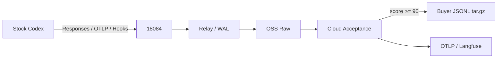

# 芯迹（ChipTrace）

<p align="center">
  <a href="https://github.com/XS-MLVP">
    
  </a>
</p>

<p align="center">
  <a href="https://github.com/XS-MLVP"><strong>万众一芯团队</strong></a>
  ·
  <a href="https://open-verify.cc/">官方网站</a>
</p>

面向芯片行业代码 Agent 的 Trace 采集与训练数据验收框架。ChipTrace 在云端保存 Stock
Codex 的 Responses Wire、原生 OTLP 和生命周期 Hook，组装完整 Session，并只交付通过
Buyer v7 硬门槛的 UTF-8 JSONL `tar.gz`。

当前线上复核（2026-10-17 04:06，Asia/Shanghai）确认传输进程仍存活，但业务门禁未通过：
Gateway outbox `pending=0`、`processing=0`、`recentFailureCount=0`、
`unresolvedHistoricalFailedFiles=0`，293 个历史失败原件和 293 个 recovery receipt 均保留；
Collector/Relay 队列为空且 `conservation_ok=true`，Collector/Relay 实际 revision 都是
`e5237065ff3a48623179c5846ff1916040030c9a`；维护分支已包含 Gateway/Platform revision
对齐门禁，但这些修复尚未部署。
Relay 的 `ingest_coverage` 为 `degraded`：`quality_errors=659`（全部来自 `otlp_traces`）、
Wire 已约 44.6 分钟未刷新，`required_sources_fresh=false`、`turn_capture_ready=false`，
279/293 条历史 Wire 有 Turn 身份。带质量、新鲜度和 revision 门禁的 runtime gate 真实退出 1。
18086 平台 `/health` 当前通过，但这只证明导出进程存活；Gateway OCI revision
`e57480eca4fe11769c5fcb8787266ab6b77ce4d5` 与待发布维护 revision 不一致，新的 Gateway preflight 会拒绝它。
因此当前不能对外承诺真实 Session/Turn 全量采集或生产导出。详见[生产就绪评估](docs/production-readiness.md)。

## 主线



用户主机不运行 ChipTrace 程序。管理员下发 Stock Codex 原生
[配置与 required Hooks](integrations/codex/README.md)，用户继续直接运行 `codex`。
Wire、OTLP 和 Hook 使用 Stock Codex 自带的 Session、Turn、call ID 和 W3C Trace Context
精确关联；缺失或冲突时拒绝交付，不补造 Schema、状态、模型身份或任务边界。

当前真实客户端仍有未归属的 SSE 日志和 span，完整 v2 交付尚未通过真实验收。
已验证的能力与剩余来源上下文缺口见[原生 Turn 验收记录](docs/native-turn-context.md)。
`audit-session-context` 提供只读的上下文缺口统计和有界定位样本；CI 使用精简的真实
客户端元数据回归，完整对话和原始取证档保留在运维侧。

2026-10-16 18:42（Asia/Shanghai）的线上快照已将 Collector、Relay 和平台服务升级到维护
提交 `30f6d243d527732acbfae4970a740ec88c8451cf`：三个容器均使用内容摘要镜像、非 root、只读根、
资源限额和持久 NFS 挂载，18084、3011、3012、18086 均返回 200。Collector/Relay 队列为空且
计数守恒，平台已通过鉴权健康检查；平台当前实际后端是本地 FS，尚未接入真实 OSS。
同一窗口的 runtime gate 真实退出 1：Relay/Collector revision 均为该提交，Collector 与 Relay
均为 `1,164,002` 条且 pending/inflight/failed 为 0，但 Relay 的 Wire 只有 4 条、成功的
逐 Turn HTTP 2xx 为 0，Wire 已落后约 31.5 分钟，覆盖为 `degraded`。因此当前部署不能声称
已完成任意 Session 的逐 Turn 全量交付。

截至 2026-10-15，最新隔离的 patched Canary 已用真实 `0.163.0-alpha.11` 上游客户端完成
两个 Native Turn、resume、失败工具进程和延迟 `write_stdin` 场景；四路来源齐全，审计
计数守恒，仓库门禁输出 `native_turns=2`、`selected_audit_records=3621`、
`delivery_ready=true`。这是带生产者上下文补丁的隔离证据，不是未修改 Stock Codex 的发布
证明；脱敏 fixture 只保存元数据，不包含 Raw 或对话正文。

此前复查确认 Collector/Relay 曾运行 revision
`fe9fcf924b226099202cb770b7cf0da29e0c2310`，18084、3011、3012 返回 200；传输队列排空且
`conservation_ok=true`。新 Relay 进程内仅有 1 条 Wire；只读活动 WAL 快照确认它是没有
原生 Session/Turn 的 HTTP 403，不能作为真实 Turn 的采集证据。OTLP/Hook 仍有流量，
随后 Wire 超过 5 分钟未更新，runtime gate 真实退出 1。18084 保留 293 个历史失败文件
（约 267 MB），trace exporter 未启用，
watchdog 仍有错误；18086 当时没有监听。已核验基线 `08cadf5` 的远端 CI 已确认 5/5 作业通过，覆盖
原生 Hook 持久化确认、生产者缓存、流式下载及图片/计划/五类真实工具的双轮 resume 采集；
新增原生协议采集使用带补丁生产者和合成模型，不替代线上验收。
2026-10-16 新执行的同模型双轮协议联测已贯通 FS 归档、恢复和 Buyer 下载，实际解包
复核两轮、12 次请求引用与全部工具结果；模型切换、取消和断流保留独立拒绝回归。
正向数据 score=100，仍是合成模型与带补丁生产者的实现证据，详见生产就绪评估。
独立手动压缩的新采集已验证摘要跨后续轮次和新进程恢复，归档、恢复、投影下载和重启
检查通过；内联压缩和缺少边界 Hook 仍拒绝交付。该修复尚未部署，详见同一评估。
自动压缩新联测还覆盖轮前、轮中、轮后和跨进程恢复；缺失压缩生命周期时，即使业务
Stop 和四源存在也拒绝完整交付，原始失败证据保留。验证范围与限制见同一评估。
真实 OSS 账号及未修改客户端的 v2 多轮验收仍未完成，因此尚不能按生产就绪对外交付。
2026-10-16 另用官方未修改 `0.163.0` 新执行双轮采集，四源和协议完整，但来源上下文
仍有缺口，交付检查实际失败。CI 新增固定官方二进制的独立诊断；诊断成功仅表示复现
了拒绝，报告始终不声明生产就绪，详见同一评估及[验证命令](docs/native-turn-context.md)。

接入排查还复现了系统默认 Provider 被用户配置覆盖、使 Wire 绕过采集的风险。
受管 requirements 模板现已强制 Provider 选择和完整网关定义，并增加固定版本未修改
客户端的断网配置回归；部署方式和能力边界见 [Stock Codex 接入](integrations/codex/README.md)。
线上主机的实际用户级配置仍存在 Provider 覆盖风险，不能视为线上 Wire 已恢复；当前 runtime
gate 的 Wire/Hook 缺失正是该风险的可观测结果。
仓库 runtime gate v3 另要求近期有明确 Session/Turn、无上下文冲突的 HTTP 2xx Wire，
并拒绝缺少该统计的旧 Relay；重复投递不能刷新这类证据。完整评估和发布条件见
[生产就绪评估](docs/production-readiness.md)。维护分支包含该门禁；线上是否生效必须用实际
部署 revision 运行 runtime gate 核对，不能按分支或历史提交号推断。当前真实失败仍须在受管
Provider 和完整 Hook 生效后重新验收。

## 构建

要求 Rust 1.91+。

```bash
cargo build --release --locked
cargo test --workspace --all-targets --locked
cargo clippy --workspace --all-targets --locked -- -D warnings
make m0-test
```

## 验收

`cloud-acceptance` 是唯一采购验收入口。它从已提交 Raw Archive 开始，依次复验原始对象、
Sub2API 精确路由、Canonical Schema、OTLP 树、Session、Buyer v7、Release 和采购包；任一
步骤失败即返回非零状态。

```bash
chiptrace cloud-acceptance \
  --archive-id raw-20260902-01 \
  --backend oss \
  --endpoint https://oss-cn-hangzhou.aliyuncs.com \
  --bucket trace-dataset \
  --prefix chiptrace \
  --usage-log /srv/sub2api/usage.jsonl \
  --session-id <stock-codex-session-id> \
  --release-id release-20260902-01 \
  --output /srv/chiptrace/acceptance/release-20260902-01
```

通过结果必须同时满足：`delivery_ready=true`、有效轮次不少于 10、不同工具不少于 5、
完整工具定义不少于 5、去尾配对率 100%、Buyer v7 分数不低于 90、全部 hard gate 通过、
OTLP 单根且内部父引用全部可解析。

## 文档

- [架构](docs/architecture.md)
- [部署与运维](docs/operations.md)
- [数据契约](docs/data-contract.md)
- [验收矩阵](docs/acceptance-matrix.md)
- [生产就绪评估](docs/production-readiness.md)
- [交付格式](docs/delivery.md)
- [OpenAPI](schemas/openapi.yaml)
- [云平台嵌入插件](integrations/cloud-platform/README.md)
- [生产者支持策略](integrations/codex/producer-support.json)
- [Provider Responses 前置门禁](docs/operations.md#provider-responses-前置门禁)

## 磁盘恢复与平台嵌入

原始 sealed WAL 以 Manifest + Checkpoint 提交到 FS、OSS 或 S3。平台插件在服务端固定对象
存储配置，先将提交的 Raw 恢复到受保护的本地工作目录，再按页提供原生 Session/Turn，
并只下载经过完整校验的 Buyer 包。插件的 ACK、任务状态、Turn sidecar 和输出校验均落到
磁盘；服务重启会重新排队未完成任务。平台 API、Node SDK、容器镜像和 Compose 示例见
[cloud-platform](integrations/cloud-platform/README.md)。
Turn 分页保持原 JSON 格式，校验后流式返回完整选中记录；`streamTurns` 可流式读取分页，
`downloadTurns` 可下载全量 JSONL。对象形式的 `getTurns` 仍需由调用者容纳所选数据。

## 许可证

本项目使用 [Apache License 2.0](LICENSE)。
